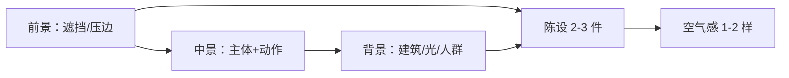

# Prompt recipes — richer frames without losing the shot

A prompt that only names the subject and a style produces a flat portrait. Build each image prompt in a fixed order, and make the shot's facts survive the style.

## Order

1. **Shot fact.** Who, how many, doing what, where. Empty frame: start with `no people in frame` (or the project's language equivalent). One person: `one person only`. One child: `exactly one child`.
2. **Framing.** Shot size, angle, lens intent. Use natural language: `wide shot from the tent opening`, `medium shot, waist up`, `low angle`.
3. **Three planes.** Foreground object or texture; midground subject; background architecture or landscape. Name each plane explicitly, or the model collapses them into one flat plane.
4. **Light.** Source, direction, hardness, color temperature, practicals. Not `cinematic lighting` alone. Example: `cold window light from camera left, warm candle practicals below, hard rim on the shoulder`.
5. **Atmosphere.** Haze, dust, steam, smoke, falling snow, rain. One or two, not all.
6. **Material.** Fabric weave and wear, wood patina and cracks, brass oxidation, paper fiber, stone pores. Two or three per prompt.
7. **Capture.** Camera, lens, depth of field, film stock or sensor look. Keep it after the content.
8. **Era and continuity.** `ERA_SPEC.md` anchors, costume and hair constraints, character anchor references.
9. **No-text clause.** Paper, edicts, plaques, and folds are blank or have illegible strokes.

## Scene light table

| Scene class | Key light | Fill / practicals | Atmosphere |
|---|---|---|---|
| `object` | single hard side light, raking | none or a thin bounce | dust motes in the beam |
| `tent` | cold light through the tent seam | low candle or brazier | smoke, breath vapor |
| `study` | cold window lattice light | candle on the desk | dust in the light shaft |
| `corridor` | daylight from the far end | lantern pools between columns | haze, floor reflection |
| `hall` | high window shaft and candle collision | rows of candles, dark eaves | incense smoke |
| `outdoor` | low side-back light | sky fill | grass, snow, or dust in the wind |

## Count and action lock

State the count and the action in the positive sentence, then repeat the count in a short clause: `one person only`, `exactly one child in his arms`, `the frame is empty`. A negative list is not enough: many samplers run at CFG 1, where negatives are ignored. When the service exposes CFG, raise it only for a failed shot; do not change the batch default.

## Exposure guard

Rich low-key prompts drift dark. Keep no more than two of `low-key`, `dark`, `deep shadow`, `underexposed` in one prompt. Always add a named key light plus `shadow detail, midtone separation`. Check the histogram during QC; if the median sits below the lower third, lift the render or rebalance the prompt rather than stacking more atmosphere.

## Skeleton

```
[count/action fact]. [place].
[framing].
Foreground: [object/texture]. Midground: [subject + action]. Background: [architecture/landscape].
Light: [source, direction, hardness, color temperature, practicals].
Atmosphere: [one or two].
Materials: [two or three].
[era anchors + costume/hair constraints].
[camera, lens, depth of field, film stock].
No readable text; paper and plaques are blank or illegible.
```

## Period screen realism

Two different failures look alike: a costume that is historically plausible but reads as "generic ancient China", and a face that reads as a rendered doll. Fix both in the positive prompt, then reinforce with the negative list.

**Positive realism block** (append after the character and costume sentence):

```
photorealistic film still from a historical drama, real actor, natural skin texture with visible pores, fine lines and subtle imperfections, anatomically correct hands with five fingers, period-correct hairline, practical light, 35mm film grain, restrained color grade
```

**Qing screen baseline** (when the subject is Qing): shaved forehead with a queue, court hat with a finial, horse-hoof cuffs, court beads, rank badge on the surcoat, cloth that wrinkles and shows wear. State the rank and the occasion; a Qing emperor in daily dress is not in full ceremonial yellow.

### 清装必须写形状，不能只写"清代"

`清代官员`、`清宫朝服`、`古装` 这几个词在图像模型里是**弱锚点**：训练数据里"中国古代官员"压倒性地是明制，只给朝代名，回来的是乌纱帽、展角、束发、道袍。实测 2026-11-18 一条 15 分钟清代片子，74 条提示词里有 33 条命中这条，全部集中在"官员/人影/官服"这种只写身份、没写形状的句子上。

规则：**句中有人物，就必须同时给出帽型、发式、袍式三件**，每件用可画的形状词，而不是等级词。

| 项 | 可画的正向词 | 不要只写 |
|---|---|---|
| 帽 | 圆锥形凉帽、帽檐上翻的暖帽、帽顶红缨与顶珠、圆锥帽配花翎 | 顶戴花翎、官帽 |
| 发 | 前额剃光、脑后一条辫子、额前无发、头顶无发髻 | 清代发式 |
| 袍 | 圆领对襟补褂、胸前方形补子、马蹄袖、颈挂朝珠、披领 | 清代官服 |

**可直接粘贴的锚点块**（按角色取一行，接在人物句后）：

```
官员（朝会）：身穿石青色圆领对襟补褂，胸前方形仙鹤补子，颈挂朝珠，头戴圆锥形暖帽，帽檐上翻，帽顶红缨与顶珠，前额剃光，脑后垂一条辫子，袖口马蹄袖
官员（日常/便服）：深蓝色长衫外罩马褂，头戴瓜皮帽，前额剃光，脑后垂一条辫子，脚穿黑布鞋
皇帝：明黄色常服袍，马蹄袖，腰系明黄带，头戴圆锥形朝冠，帽顶东珠，前额剃光，脑后垂一条辫子
旗人女子：两把头，氅衣阔镶边，立领大襟
太监/差役：青色短褂，瓜皮帽，前额剃光，脑后垂一条辫子
```

**反向也要写死**：帽子写成"圆锥、上翻、红缨"，模型就不会画展角；写"前额剃光、头顶无发髻"，就不会画束发。否定清单（`no Ming hat` 一类）在 CFG 1 下经常被忽略，只能当补刀，不能当主锁。

**改稿也要重跑**：加过锚点的提示词先过 `python3 scripts/era_lint.py <prompts-dir> --era qing`，退出码 0 再进批量。lint 只看提示词文本，不看图，所以它拦的是"注定画错"的提示词，不是"已经画错"的图。

**Negative list** (add to the project's era negatives, not instead of them):

```
plastic skin, airbrushed face, beauty filter, doll face, wax figure, CGI, 3D render, anime, cosplay, extra fingers, fused fingers, deformed hands, modern makeup, contact lenses, veneers, bodybuilder physique, brand-new costume, costume-shop sheen, Ming dynasty clothing, Ming official cap, black gauze hat with wing flaps, topknot, hair bun, cross-collar robe, Japanese clothing, Western clothing
```

A group shot needs `distinct faces, real casting, no repeated face`. A hands-visible shot needs `hands relaxed and anatomically correct`; hands are the cheapest realism check and the first thing a viewer notices.

**Prestige period-drama look.** When the brief asks for a TV-drama still, name the production level rather than the genre: `prestige historical drama, on-set production still, elaborate set dressing, practical candlelight, restrained grade, 35mm`. Add `not a short-form drama, not a studio portrait, not costume rental` to the negative list. "古装/清朝/电影感" alone collapses to a generic costume portrait; the production-level words are what separate a drama still from a photo studio.

## 画面密度：别把镜头压成单层静物

单光源暗调最容易踩的坑，不是黑，是**空**：背景被压成一堵黑幕，中景只有一件东西，前景什么也没有，观众看到的就是"一张图"，不是一个空间。这一条和曝光守卫是两回事——曝光管亮不亮，密度管有没有纵深。

硬规则，每条人物/物件提示词都要满足：

1. **三平面写全**：前景给一件遮挡物或压边物（门框、纱帘下摆、栏杆、树影、烛台边缘、器物的一角）；中景是主体和动作；背景给建筑、光源或人群。少一层，画面就塌成一张贴纸。
2. **陈设两到三件**：条案、宫灯、屏风、炭盆、铜盆、书架、卷轴、茶盏、棋盘、香炉。不是装饰，是尺度参照和纵深线索。
3. **人物镜头里再加一个人影**：随从、候着的差役、远处走过的宫人。单人独照只留给刻意的孤绝时刻，不能整片都是。
4. **空气感**：烟、尘、蒸汽、雪、雨、哈气，选一样。暗调画面里没有介质，前后景就分不开。
5. **景别要换**：每 8–10 镜至少一个全景定场；物件特写不连续超过两个；特写必须带环境线索（桌沿、窗格、烛台），不能是一张浮在黑色里的纸。

反例（单层静物，出来一定单薄）：

```
案上摊着一本空白的奏折，一支朱笔搁在旁边
```

正例（同一件事，三个平面 + 陈设 + 介质）：

```
前景是笔架与砚台压住画面下缘，中景三本奏折并排摊开、纸面空白，一支朱笔搁在青瓷笔架上，背景是紫禁城书房的窗棂与半架线装书，烛火从右下打上来，空气里有浮尘
```



## Delivery quality floor

- Resolution: for 9:16 request at least `1280×2276`, prefer `1440×2560`; for 16:9 at least `2276×1280`. Upscaling does not add detail, so a service that only returns 1024-wide images is a capability gap, not a style choice.
- Reference capability: prefer a service that accepts a reference image or img2img. Text-only generation cannot hold a face across shots; if the service has no reference input, record that limit before batch and do not promise character consistency.
- Candidates: generate two candidates for each pilot shot and keep the better one by face, hands, and action. For batch shots, one candidate is enough after the pilot locks the look; regenerate only QC failures.
- Realism crops: inspect eyes, hands, and hairline at 100% on the pilot contact sheet. A face that survives a thumbnail but breaks at 100% is a replacement.
- If the chosen service cannot meet the floor, say so before spending on a batch: name the missing capability and offer a stronger provider, instead of producing a full set that will be rejected.

## QC before batch

For each pilot image check: count, action, era, character identity, text, exposure, and whether the three planes are actually visible. For realism, check skin texture, hands, hairline, fabric wear, and whether the face looks like a photograph of a person rather than a render. For Qing, check the screen baseline: shaved forehead, queue, hat, cuffs, beads, rank badge. A missing action, wrong count, wrong dynasty, plastic face, or malformed hand is a replacement-level defect; a slightly dark frame is a grade adjustment.

**判朝代先判帽子。** 乌纱帽、展角幞头、梁冠、束发髻、交领道袍，任一件出现就是明代或更早，不是"风格接近"，也不是"过场镜头可以接受"——观众认朝代靠的就是头。提示词层面先用 lint 拦一遍：

```
python3 scripts/era_lint.py images/prompts --era qing
```

退出码非 0 不许进批量。图层面再按"帽型 → 发式 → 领型"三件顺序过一遍；人物的脸可以糊，帽子不能错。
